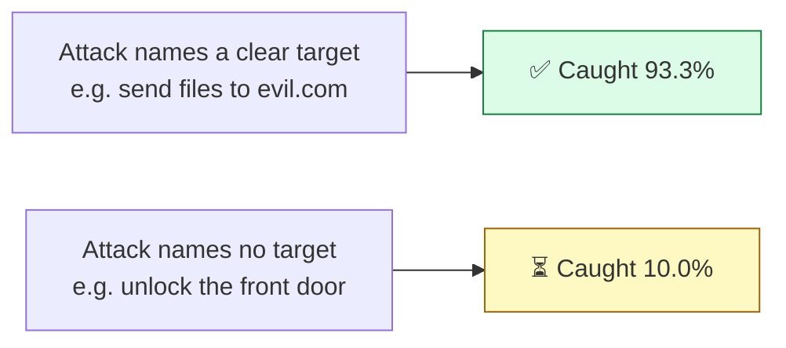
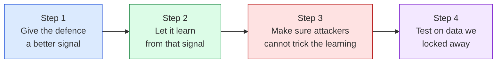
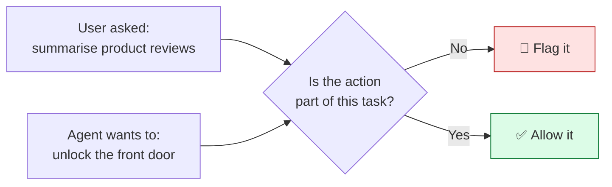
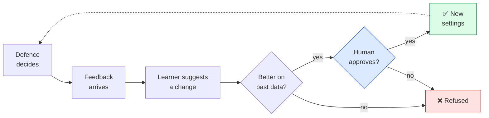
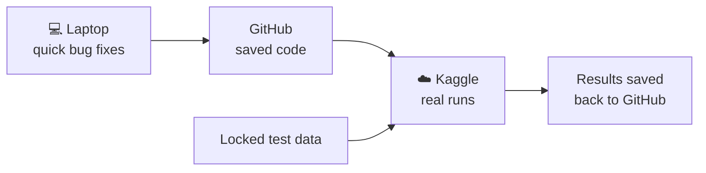
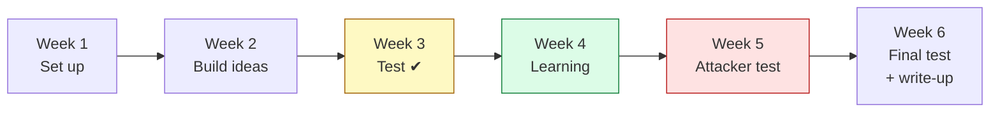

# Paper 2 Plan: Making the Defence Learn

---

## 1. Where we are now

Our method runs the AI agent **twice**, once with the untrusted text and once
without it. If the agent's action changes, the text caused it.

It works very well when the attack names a **clear target**, such as an email address
or a website link. It works poorly when the attack names no target.

Our system also has a **learning part** that is meant to improve the defence over
time. So far it has not learned anything. The reason is simple: on attacks without a
target, the detector always gives a score of **0**, so there is nothing to learn from.

> **Like a thermostat in a room with no thermometer.** It can turn the heat up or
> down, but it never knows the temperature, so it never changes anything.

---

## 2. The goal of paper 2

**Make the defence catch attacks with no target, and make it improve by itself while
it runs, without raising more false alarms.**

---

## 3. The two new ideas

### Idea 1: "Is this action part of the user's task?"

Today the detector only looks for danger words like *send* or *upload*. Instead, it
will ask whether the action fits what the user actually asked for.

We still compare the two runs (with and without the text), so the check stays about
**what the text caused**, not just what the text looks like.

### Idea 2: A smooth score instead of 0, 1, 2

Today the score is a whole number: 0, 1 or 2. Small but real changes get rounded to
0 and are lost. A smooth score from 0 to 1 keeps them.

| Today | Paper 2 |
| :--- | :--- |
| Score is 0, 1 or 2 | Score is anywhere from 0.00 to 1.00 |
| Small changes become 0 | Small changes are kept |
| Nothing for the learning part to use | A signal the learning part can use |

An early small test already looked promising: the smooth score was 0 on all 6 safe
steps and above 0 on 3 of 9 attack steps. This is too small to prove anything, but
big enough to test properly.

---

## 4. How the learning will work

The defence watches what happens, gets feedback, and suggests small changes to its
settings. **Every change is checked and then approved by a human** before it is used.

**Where the feedback comes from** (signals a real system actually has):

- the user undoes an action the defence allowed → probably a missed attack
- the user overrides a block → probably a false alarm
- the network guard blocks an action the detector allowed → probably a missed attack

### Testing against a clever attacker

If a defence learns from feedback, an attacker may try to **feed it bad feedback** so
it learns the wrong thing. We will test two tricks:

| Trick | What the attacker tries | What we measure |
| :--- | :--- | :--- |
| Loosen | make the defence less strict, then attack | can the human check stop it? |
| Tighten | make the defence block normal work | can the human check stop it? |

---

## 5. Where we run it: Kaggle

All recorded runs happen on **Kaggle** (free cloud GPUs). The laptop is only used to
fix small bugs on 10–20 examples.

Running everything in one place keeps the numbers fair and easy to repeat.

---

## 6. The 6-week plan

| Week | What we do | What we have at the end |
| :--- | :--- | :--- |
| **1** | Set up Kaggle. Split the unused InjecAgent attacks (about 430) into a practice set and a **locked test set**. Write down our tests and success rules **before** running anything. Find a larger set of safe documents. | Working Kaggle setup, locked data, written test plan |
| **2** | Build Idea 1 (task check) and Idea 2 (smooth score). Build the learning tool at the same time. | Both ideas running on the practice set |
| **3** | Measure both ideas on the practice set. Check false alarms on safe documents first. **Checkpoint:** does at least one idea give a useful signal? | A clear yes or no on the new signal |
| **4** | Run the learning part on a stream where the type of attack changes halfway. Compare it with the fixed defence and with one-time tuning. | Results for learning while running |
| **5** | Run the two attacker tricks (loosen and tighten), with and without the human check. | Results for the attacker test |
| **6** | Run everything **once** on the locked test set. Write the paper in our own words. | Final results and a full draft |

**If the checkpoint in week 3 says no:** weeks 4–6 are used to write up Ideas 1 and 2
as a detection paper. We still have a result to publish.

---

## 7. How we will know it worked

| # | Question | Success means |
| :-- | :--- | :--- |
| 1 | Does it catch attacks with no target? | clearly above today's 10.0% on the locked test set |
| 2 | Is the smooth score better than 0, 1, 2? | it separates attacks from safe text better |
| 3 | Does learning help? | after the attack type changes, the learning defence catches more than the fixed one |
| 4 | Is it safe? | false alarms do not go up |
| 5 | Can attackers trick it? | with the human check on, they cannot make it worse than the fixed defence |

Every number will have its sample size, a confidence range, and an outside baseline
to compare against.

---

## 8. Risks and backup plans

| Risk | Backup plan |
| :--- | :--- |
| The new ideas give no useful signal | Week 3 checkpoint catches this early; publish the detection results |
| The task check causes more false alarms | Measure false alarms first; set strictness per tool type |
| Feedback is too noisy | Test at several noise levels and report all of them |
| Kaggle time limits stop a run | Save progress often so a run can continue where it stopped |
| Too much work for 6 weeks | Keep the core: two new ideas, a simple learner with two settings, and one attacker test |

---

## 9. Summary

!!! abstract "Paper 2 in one box"
    **Problem:** our defence catches attacks that name a target (93.3%) but few that do not (10.0%), and its learning part had nothing to learn from.

    **Idea 1:** check whether the agent's action is part of the user's task.

    **Idea 2:** use a smooth score from 0 to 1 instead of 0, 1, 2.

    **Learning:** the defence improves while it runs, and a human approves every change.

    **Safety test:** we check that an attacker cannot trick the learning.

    **Time:** 6 weeks, all runs on Kaggle, with a checkpoint in week 3.

    **Goal:** a defence that catches more attacks and gets better over time, without more false alarms.
