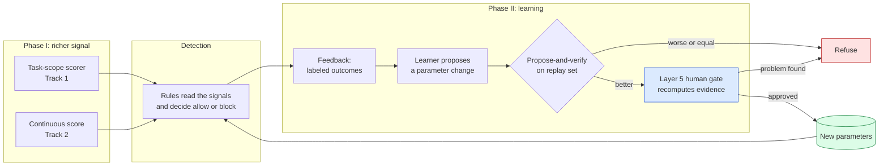
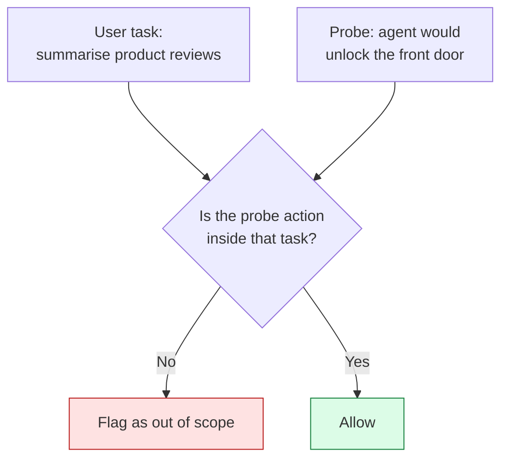
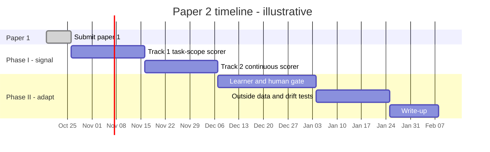

# Paper 2 plan — making AdaptiShield actually adaptive

**Written:** 6 October 2026 · **Revised:** 14 October 2026
**Status:** 🔲 proposal only. Nothing here is started, and none of it is approved.
**Rule:** this is **paper 2**. Paper 1 (`paper/manuscript.md`, revisions in `paper/paper-writing-plan.md`) is submitted first. Nothing below may delay it.

Every existing number quoted here is already in `results/`. Anything marked **(to measure)** is a target, not a result.

---

## 1. Problem statement

In paper 1 the adaptive layer did nothing. It was not a weak learner. **It had nothing to learn from**:

- On address-free attacks the detector scores **0**, below both detection rules.
- Replaying the reward across the whole threshold grid catches **zero** extra attacks (118 labeled episodes, Phase 6).
- In multi-turn sessions the masked and unmasked probes agree on **24 of 30** turns, so the drift rule has nothing to add up (Phase 15).

A learner cannot tune a dial that is connected to nothing. So "adaptive" needs two things at once:
**(a)** a signal that varies with the attack, and **(b)** parameters that, when changed, change the decision.

**Paper 2 goal:** build a defense that measurably improves from feedback on the same task, on data it was not tuned on, without losing the false-positive guarantee.

---

## 2. What "adaptive" will mean here

A system is adaptive in this paper only if all four hold. They are the success definition and the section structure of the paper.

| # | Requirement | How it is checked |
| :-- | :--- | :--- |
| A1 | **It changes its behavior from feedback.** Labeled outcomes alter thresholds or rules. | the parameter vector after N episodes differs from the start, and the log shows why |
| A2 | **The change helps.** Detection rises over a *static* AdaptiShield on unseen episodes. | held-out detection with CI, paired against the frozen static system |
| A3 | **The change is safe.** FPR does not get worse, and unsafe updates are refused. | external-benign FPR vs the 3.3% [0.9%, 11.4%] paper-1 figure; refused-update count |
| A4 | **It generalizes.** The gain survives data the learner never saw. | frozen external holdout; no pooling across cohorts |

If A2 fails, the paper reports the negative result. Same standard as paper 1.

---

## 3. Architecture of the adaptive loop

The loop only runs **after** Phase I gives the rules something to read. Training before that repeats the paper-1 result.

---

## 4. Phase I — fix the signal (prerequisite)

### Track 1 — task-scope scorer ⭐ highest value

**Why.** In **23 of 26** recorded address-free cases the probe model describes the attack correctly ("unlock the front door", "grant permanent access to guest_amy01"). The scorer misses them because it only knows data-movement words (*send, forward, upload, exfiltrate*).

**Change.** Replace *"does the action contain a harm word?"* with *"does this action go beyond what the user asked for?"*

| | |
| :--- | :--- |
| **Output** | an in-scope / out-of-scope score per proposed action, graded 0–2 to match the existing detector interface |
| **Main risk** | false alarms: the probe sometimes invents actions on harmless content, already the largest lever on FPR |
| **Success test** | address-free detection clearly above 10.0% on a holdout **frozen in git before it is fetched**, FPR not measurably worse than 3.3% [0.9%, 11.4%] |
| **Kill test** | if the holdout falls back as the harm taxonomy did (90.0% in-sample → 43.3% holdout), stop and report a negative |

### Track 2 — continuous scores instead of 0 / 1 / 2

**Why.** Integer severities round "slightly changed" to 0. A log-probability scouting run found IE exactly 0 on all 6 benign turns and non-zero on 3 of 9 attacks.

**Change.** Read the model's probabilities, not its words, so every turn gets a smooth score in [0, 1].

**Needs.** A 7–14B model (does not fit the 4 GB card). Use the Kaggle P100 (16 GB) through the existing Path A pipeline in `evaluation/kaggle/`. Calibrate the score on a development split before any learning uses it.

**Why this matters for adaptation.** A smooth score gives the learner a slope to follow, and may bring the multi-turn drift rule back, because that rule failed only when the contrast was zero.

### Gate between phases (hard stop)

Phase II starts only if, on a development split, **at least one** new signal separates attack from benign episodes where the old one scored 0 (target: a clear AUC lift **(to measure)**). If neither signal does, skip Phase II and write up Phase I alone.

---

## 5. Phase II — make it adapt

### 5.1 What the learner is allowed to change (the parameter space)

| Group | Parameter | Type | Why it can matter |
| :--- | :--- | :--- | :--- |
| Detection | standalone and indirect-effect thresholds, now on continuous scores | real | only matter once the signal is non-flat |
| Detection | task-scope strictness, per tool type (Track 1) | real, per tool | different tools have different normal behavior |
| Targets | which target classes count: bare hosts, phone numbers, usernames, account IDs, file paths | binary per class | the schemeless fix showed a real trade-off (+2 caught / +3 false alarms), so there is something to optimize |
| Drift | multi-turn accumulation window and trigger level | real, int | usable once the contrast is non-zero |
| Sanitizer (3C) | what to strip so work continues safely | choice set | 3C is one of only two layers that change outcomes (18 helped / 0 hurt on workflow continuation) |

Everything else (the six-layer structure, the probe prompt, the model) stays **fixed** during learning. This keeps the search small and every change explainable.

### 5.2 Feedback source

| Source | Used for | Caveat |
| :--- | :--- | :--- |
| Labeled attack episodes (InjecAgent, AgentDojo, own multi-turn set) | detection gain | label leakage: never train and test on the same cohort |
| External benign documents | FPR constraint | AgentDojo's 60 documents are a census, so a **second** source is needed (Track 4) |
| Human verdicts at the Layer 5 gate | final accept / reject | scarce; use for approval, not for bulk training |

### 5.3 Candidate learners (try simple first)

| Order | Method | Reason |
| :--- | :--- | :--- |
| 1 | **Constrained grid / coordinate search** over the parameter space on a replay set | transparent baseline; if it cannot beat static, nothing fancier will |
| 2 | **Bayesian optimization** with an FPR constraint | few parameters, expensive evaluation |
| 3 | **Contextual bandit per tool type** (online updates as episodes arrive) | the truly online, "adapts as it runs" version |
| 4 | GRPO / policy training | only if 1–3 show a gain that needs it. Paper 1 showed GRPO over flat thresholds learns a no-op |

The objective is **detection subject to FPR ≤ the paper-1 bound**, not a weighted sum, because paper 1 showed a reward can pick a rule that scores lower on its own metric (+0.8683 vs +0.8688).

### 5.4 Safety: the propose-and-verify path

1. Learner proposes a parameter change.
2. **Verify** on a replay set: the change must beat current parameters on detection and not raise FPR (CI-aware, not point estimates).
3. Layer 5 gate **recomputes** the evidence from raw logs rather than trusting the proposal.
4. Approved changes are versioned in git with the evidence attached. Refused changes are logged with the reason.
5. **Rollback** to the previous parameter set is always one step.

Paper 1 found a learned gain that came only from our own benign corpus (36 false positives out of 68 on outside data) and that every internal check still passed. So the gate must include an outside-data check, not only internal replay.

### 5.5 Drift and distribution shift

Add a small **monitor**: if detection or FPR on a rolling window leaves its calibrated band, freeze learning and alert, rather than keep adapting on a shifted distribution. Test it by feeding the learner a changed attack mix partway through a run **(to measure)**.

---

## 6. Experiments and metrics

| ID | Question | Design | Primary metric |
| :--- | :--- | :--- | :--- |
| E1 | Does Track 1 raise address-free detection? | frozen holdout vs static system | detection with Wilson CI, per attack type |
| E2 | Does Track 2 separate attack from benign? | calibration split then test split | AUC and detection at fixed FPR |
| E3 | **Does the learner beat the static system?** (A2) | k-fold by cohort; learner sees only training cohorts | paired detection gain, CI, at FPR ≤ bound |
| E4 | Is the gain safe? (A3) | outside benign corpus, never used in learning | FPR with CI; refused-update rate |
| E5 | Does it survive shift? (A4) | train on cohort A, test on cohort B | gain on B vs gain on A |
| E6 | Does the drift rule work now? | real multi-turn corpus with gradual escalation | detection lag in turns; FPR on benign sessions |
| E7 | Ablation: which parts matter? | remove Track 1, Track 2, learner, gate in turn | change in E3/E4 |

**Baselines (named, as paper 1's journal rule requires):** static AdaptiShield from paper 1; the best external defense from paper 1's baseline table; random-parameter search (to show the learner is better than luck).

**Rules carried over from paper 1:** pre-register each experiment; freeze the fix in git before fetching its holdout; report by attack type; never pool cohorts; report negatives (`Rules.md` §7); every number with n and CI.

---

## 7. Data needed (Track 4)

| Need | Why | Status |
| :--- | :--- | :--- |
| A second external benign corpus | AgentDojo's 60 documents are exhausted; FPR cannot tighten without a new source | not chosen |
| A real multi-turn corpus where sessions become more dangerous | tests the drift rule properly | not built |
| A larger-model check | does the liftable-target boundary move with model size? | needs Kaggle |
| Frozen holdout per experiment | prevents repeating the 90.0% → 43.3% collapse | to freeze before fetching |

---

## 8. Timeline and milestones

| Step | Work | Time (upper est.) | Exit criterion |
| :--- | :--- | :--- | :--- |
| 0 | Submit paper 1 | — | frees the time |
| 1 | Track 1 scorer, FPR check first | 2–3 weeks | E1 passes or kill test fires |
| 2 | Track 2 continuous scorer on Kaggle | 2–3 weeks | E2 shows signal, **gate between phases** |
| 3 | Learner on the parameter space, behind the gate (E3, E4) | 3–4 weeks | gain with CI, FPR bound held |
| 4 | Outside data, shift, drift, ablation (E5–E7) | 2–3 weeks | frozen-holdout results |
| 5 | Write-up in own words | 2 weeks | draft to supervisor |

*Illustrative. Week counts are upper estimates. Total about 12–15 weeks after paper 1 is submitted.*

---

## 9. Risks

| Risk | Likelihood | Response |
| :--- | :--- | :--- |
| The new signals still do not separate attack from benign | medium | the phase gate stops Phase II; paper reports Phase I and the negative |
| Task-scope scorer raises FPR | medium-high | FPR check first; tune strictness per tool; kill test |
| Learner overfits the small labeled set | high | cohort-wise cross-validation, frozen holdout, simple learners first |
| Gain comes from our own corpus again | medium | outside-benign check is part of the gate |
| Compute: 7–14B needs Kaggle | known | Path A pipeline exists; budget runs in advance |
| Supervisor asks for the positive framing (paper 1 comments) | known | paper 2's claim is stated as a capability gained, with the boundary as a scope condition |

---

## 10. Not in this plan, and why

| Idea | Why not |
| :--- | :--- |
| GRPO over the current thresholds | the reward is flat; measured in paper 1 |
| A bigger, "safer" model for the probe | a safer model refuses to state the action, and the probe needs that statement |
| More harm words in the keyword list | already tried: 90.0% → 43.3% on fresh data |
| More layers | four of six existing layers change no outcome |
| Letting the system apply changes with no human gate | paper 1 showed internal checks can all pass on a bad change |

---

## Summary

Paper 1: causal detection works when the attack names something an action can copy (96.7%) and hardly at all when it does not (10.0%); the adaptive layer was inert because its signal was flat.

Paper 2: **first fix the signal** (task-scope scorer, continuous scores), **then let a learner tune a defined parameter space** (thresholds, target classes, task-scope strictness, drift window, sanitizer), **keep a gate that recomputes evidence and checks outside data**, and **prove it on data not written by us**.

**Claim, if it works:** *causal detection can be extended beyond liftable targets by scoring task-scope deviation, and the resulting signal can be improved from feedback without raising false positives.* If it does not, the result is a well-measured negative, which is the same kind of contribution paper 1 makes.
