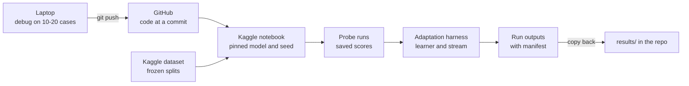
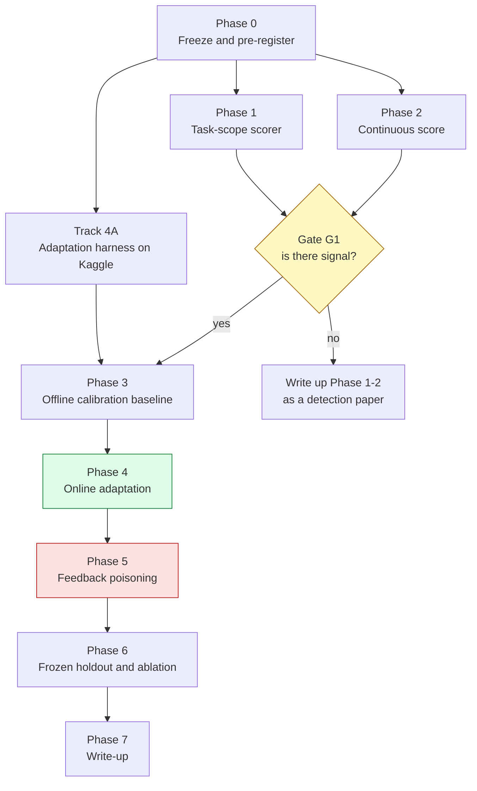
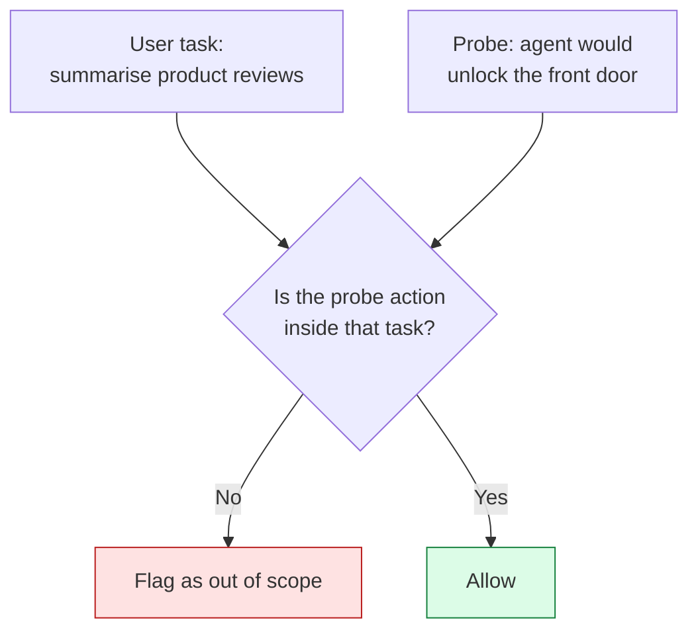
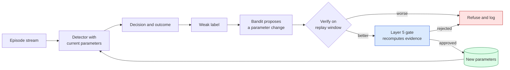
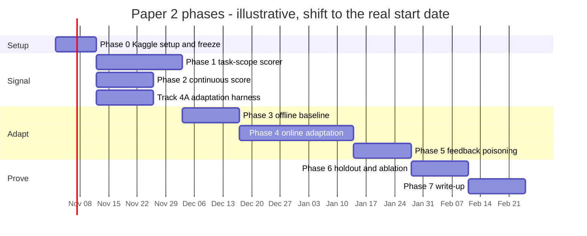

# Paper 2 plan — making AdaptiShield actually adaptive

**Written:** 6 October 2026 · **Revised:** 15 October 2026 (corrected against `results/`, broken into phases, Kaggle as the run platform)
**Status:** 🔲 proposal only. Nothing here is started, and none of it is approved.
**Rule:** this is **paper 2**. Paper 1 (`paper/manuscript.md`, revisions in `paper/paper-writing-plan.md`) is submitted first. Nothing below may delay it.

**Priority 1 for paper 2:** the Kaggle pipeline and the adaptation harness on it (Phase 0 and track 4A below). Everything else builds on them.

Every existing number quoted here is traced to `results/` or `paper/`. Anything marked **(to measure)** or **(target)** is a goal, not a result. Anything marked **(to verify)** is a claim not yet checked.

---

## 0. Corrections from the 15 October review

| # | Earlier plan said | Data says | Change made |
| :-- | :--- | :--- | :--- |
| 1 | Continuous scores need a 7–14B model on Kaggle | the log-probability scouting run used **gemma3:4b**, locally (`results/phase15/logprob_probe.json`), so 4B is enough to start | Phase 2 starts on gemma3:4b. **All recorded runs move to Kaggle** for speed and one platform (§2b) |
| 2 | "96.7% with a target vs 10.0% without" | 96.7% is our own corpus (phase 7). Same-corpus InjecAgent contrast is **93.3% vs 10.0%** (`paper/05-external-validity.md`) | use 93.3% vs 10.0% everywhere; same error flagged for paper 1's abstract |
| 3 | Success = address-free detection "clearly above 10.0%" | 10.0% is InjecAgent. AgentDojo's address-free baseline was already **30.0%** (`results/README.md`) | baselines are set **per corpus** |
| 4 | New attack data needed | InjecAgent direct-harm has **459** address-free cases; paper 1 drew 30 (`results/phase12/benchmark.json`) | the ~429 unused cases become the dev set and the frozen holdout |
| 5 | Offline grid search = "adaptive" | that is calibration; reviewers will call it tuning | the core claim moves to an **online** learner on a **shifting stream** (Phase 4) |
| 6 | No adaptive attacker | any learning defense invites feedback poisoning | new Phase 5 |
| 7 | Labels assumed | deployment has no ground truth | Phase 4 defines weak labels |
| 8 | "If it fails, the negative is the contribution" | supervisor's paper-1 comments reject negative framing | each phase has a **positive fallback** |

---

## 1. Problem statement

In paper 1 the adaptive layer did nothing. It was not a weak learner. **It had nothing to learn from**:

- On address-free attacks the detector scores **0**, below both detection rules (standalone needs 2, indirect-effect needs ≥ 1). **23 of 26** recorded address-free cases score (0, 0) while the probe's transcription of the attack is correct.
- Replaying the reward across the whole threshold grid catches **zero** extra attacks (Phase 6).
- In multi-turn sessions the masked and unmasked probes agree on **24 of 30** turns, so the drift rule has nothing to add up (Phase 15).

A learner cannot tune a dial connected to nothing. Being adaptive needs **(a)** a signal that varies with the attack, **(b)** parameters that change the decision, and **(c)** feedback that exists outside a benchmark.

**Paper 2 goal:** a defense that improves from feedback **while it runs**, on attacks it was not tuned on, survives an attacker who tries to steer its learning, and does not raise false positives.

---

## 2. Definition of "adaptive" (the success criteria)

| # | Requirement | Checked in | Pass condition (pre-registered in Phase 0) |
| :-- | :--- | :--- | :--- |
| A1 | Changes behavior from feedback | Phase 4 | parameters move during the stream, every move logged with its evidence |
| A2 | The change helps | Phase 4 | cumulative detection after the shift beats the frozen static system; lower 95% bound of the paired gain > 0 |
| A3 | The change is safe | Phases 4, 5 | FPR within the non-inferiority margin; poisoning attempts refused |
| A4 | It generalizes | Phase 6 | the gain holds on the frozen holdout and on a corpus not used in Phases 1–5 |

---

## 2b. Compute platform: Kaggle (decided 15 October 2026)

**Every recorded run in paper 2 happens on Kaggle:** the LLM probe runs, the adaptation runs, poisoning and the holdout. The laptop (GTX 1650 Ti, 4 GB) is for development only.

| Work | Where | Why |
| :--- | :--- | :--- |
| Debugging prompts and code on 10–20 cases | laptop | fast edit-run loop, no quota used |
| Probe runs over the corpora (Phases 1, 2, 5, 6) | **Kaggle GPU** | several times faster than the 1650 Ti; 7–8B models fit in 16 GB |
| Paper 1 static baseline, rerun | **Kaggle GPU** | baseline and new system must share hardware |
| Adaptation harness, learners, stream simulation (Phases 3, 4) | **Kaggle** (CPU session is enough; GPU only when the learner triggers new probe calls) | one platform for every reported number; versioned notebooks as the run record |
| Statistics and figures for the paper | Kaggle output, copied into `results/` | numbers trace to a notebook version and a commit |

**Rules**
1. **Never mix platforms in one comparison.** Every paper 2 number comes from Kaggle. Local runs are development only and are never reported.
2. **Pin the environment:** model tag and quantization, Ollama or llama.cpp version, temperature, and the commit hash, written to each run's manifest (same manifest format as paper 1).
3. **Checkpoint:** write results every N cases so a session that hits the time limit resumes from the last checkpoint instead of starting over.
4. **Freeze applies to Kaggle too:** frozen splits go up as a versioned Kaggle dataset, and its version is recorded beside the git commit.
5. **Budget the weekly GPU quota** (about 30 h/week, **(to verify)** current limits): debug locally first, so Kaggle hours go to real runs.

**Pipeline:** the existing Path A route in `evaluation/kaggle/` (API from session; only the token fetch is manual).

---

## 3. Phase overview

Phases 1 and 2 and track 4A run **in parallel**. Phase 4 is the core claim of the paper, and its harness (4A) is built first so the learner is ready the moment G1 passes.

---

## Phase 0 — Freeze, pre-register, prepare (≈1 week)

**Goal:** set up Kaggle and fix everything that could later be tuned to the answer.

**Tasks**
0. **Kaggle setup (priority 1).** Get the API token (the one manual step), extend `evaluation/kaggle/` to run the probe with checkpointing, and time 20 probe calls on Kaggle and on the laptop to replace the estimates in §2b. Rerun the paper 1 static baseline on Kaggle so every comparison shares hardware.
1. **Split InjecAgent.** Take the 459 address-free and 51 target-bearing direct-harm cases. Exclude the 60 indices paper 1 already used. Split the rest by fixed seed into **dev** (≈30%) and **frozen holdout** (≈70%), stratified by tool family. Commit the index lists before reading any case, then upload them as a versioned Kaggle dataset.
2. **Choose the second benign corpus.** AgentDojo's 60 documents are a census and are already used. Candidate sources **(to choose)**: other agent benchmarks' benign tool outputs, or real public data in the same tool shapes (emails, tickets, reviews). Target size ≥ 300 documents, so an FPR margin of a few points is measurable.
3. **Power calculation.** For each test, fix n and the decision rule. Rough guide: with n = 30, a Wilson interval is about ±20 points; with n ≈ 100 it is about ±10 points **(compute exactly)**.
4. **Write the pre-registration** (`evaluation/preregistration/paper2_*.md`): hypotheses H1–H6 (§9), metrics, n, decision rules, the FPR non-inferiority margin, and the kill tests.
5. **Literature check (to verify).** Confirm and position against defenses that may overlap: masked re-execution (MELON) vs our causal masked contrast; task-alignment checking (Task Shield) vs Phase 1. Write one paragraph per paper on what is different.

**Outputs:** working Kaggle pipeline with timing numbers, paper 1 baseline rerun on Kaggle, frozen splits in git and on Kaggle, pre-registration commit hash, chosen benign corpus, positioning notes.
**Exit:** all of the above committed **before** any Phase 1–2 result exists.

---

## Phase 1 — Task-scope scorer (≈2–3 weeks, parallel with Phase 2)

**Why.** The probe already describes address-free attacks correctly ("grant permanent access to guest_amy01", "transfer $3,000 to account number 123-1234-1234", "unlock the front door"). The scorer only knows data-movement verbs, so it returns 0.

**Change.** Stop asking *"does the action contain a harm word?"*. Ask *"does this action go beyond what the user asked for?"*

**Tasks**
1. Define the scope check: input = user task + tool list + the probe's proposed action; output = scope score, graded 0–2 (fits the existing detector) **and** a continuous version for Phase 4.
2. Implement it with gemma3:4b (debug on the laptop, record on Kaggle), comparing the proposed action with the action under the masked input, so it stays a **causal** check, not a plain classifier.
3. **FPR first:** run on AgentDojo's 60 benign documents and the new benign corpus before any attack data.
4. Run on the **dev** split only. Freeze the scorer (commit hash) once done.

**Metrics:** address-free detection per corpus (InjecAgent baseline 10.0% [3.5%, 25.6%]; AgentDojo baseline 30.0%), FPR, both with Wilson CIs.
**Exit:** dev detection lower bound above the per-corpus baseline, FPR within the margin.
**Kill test:** a dev-to-holdout collapse like the harm taxonomy's (90.0% in-sample → 43.3% holdout) is checked only in Phase 6, but if dev FPR breaks the margin, stop.
**Positive fallback:** even a partial lift on the ≈90% address-free share of InjecAgent is a detection result on its own.

---

## Phase 2 — Continuous causal score (≈2 weeks, parallel with Phase 1)

**Why.** Integer severities round small changes to 0. The scouting run (gemma3:4b, 15 turns) found IE exactly 0 on all 6 benign turns and non-zero on 3 of 9 attacks. Too small to conclude anything, large enough to test properly.

**Where:** recorded on Kaggle. gemma3:4b is enough to start.

**Tasks**
1. Turn the forced-choice log-probability margin (masked vs unmasked) into a score in [0, 1].
2. **Calibrate** on dev data (temperature or isotonic scaling). The scouting margins saturate (e.g. 12.5 vs 22.6 nats on the same turn), so raw margins are not usable as probabilities.
3. Measure separation on dev: ROC AUC, and detection at a fixed FPR.
4. Re-run the Phase 15 multi-turn sessions with the continuous score to see whether the drift rule can now fire.
5. **Size check:** repeat on a 7–8B model on the same Kaggle setup to see whether the boundary moves with size. A 14B model does not fit a 16 GB P100 without 4-bit quantization. Larger, safer models may refuse to state the action. If so, record it as a finding.

**Exit:** a calibrated score whose dev AUC is clearly above the integer score's **(to measure)**.
**Positive fallback:** a calibrated continuous causal score is a reusable contribution even without adaptation.

---

## Track 4A — Adaptation harness on Kaggle (priority 1, ≈2 weeks, parallel with Phases 1–2)

**Why first.** The learner cannot learn before G1, but its machinery can be built and tested now, so Phases 3–4 start the day G1 passes.

**Tasks**
1. Build the harness as a Kaggle notebook plus repo module: load saved probe scores, replay an episode stream, apply a parameter set, record decisions, compute metrics.
2. Implement the weak-label simulator (Phase 4, task 2) with a noise-rate setting.
3. Implement the learners behind one interface: grid / coordinate search, Bayesian optimization, contextual bandit.
4. Implement the safety path: verify on a replay window, a gate check that recomputes from raw logs, versioned parameter sets, one-step rollback, drift monitor.
5. **Dry run on paper 1's recorded probe outputs** (`results/probe_corpus/`). Expected: the learner proposes no useful change, because the paper 1 signal is flat. Reproducing that no-op is the harness's correctness test.

**Exit:** the harness reproduces paper 1's no-op on old data and runs end to end on Kaggle in one session.

---

## Gate G1 — is there signal? (hard stop)

Proceed to Phase 3 only if **at least one** of the Phase 1 or Phase 2 signals separates attack from benign on dev where the old scorer gave 0. If neither does, skip Phases 3–5 and write Phases 1–2 up as a detection paper. This is the step paper 1 lacked: never train a learner on a flat signal.

---

## Phase 3 — Offline calibration baseline (≈1–2 weeks, on Kaggle)

**Why.** Before claiming adaptation, show what plain offline tuning achieves. Phase 4 must beat this, not just the static system.

**Parameter space** (everything else frozen):

| Parameter | Type | Evidence it matters |
| :--- | :--- | :--- |
| Detection thresholds on the new continuous scores | real | only meaningful after G1 |
| Task-scope strictness, per tool family | real, per family | different tools have different normal behavior |
| Target classes counted: bare hosts, phone numbers, usernames, account IDs, file paths | on/off per class | the schemeless fix traded +2 caught for +3 false alarms |
| Drift window and trigger level | int, real | only if Phase 2 revives the drift rule |
| Sanitizer (3C) settings | choice set | 3C moves workflow continuation (18 helped / 0 hurt) |

**Tasks**
1. Constrained grid / coordinate search on dev: maximize detection **subject to** FPR ≤ margin. Use a constraint, not a weighted reward: paper 1 showed a reward can choose a rule that scores lower on its own metric (+0.8683 vs +0.8688).
2. Bayesian optimization with the same constraint, as a second baseline.
3. Record the **oracle-tuned static** setting (best fixed parameters in hindsight) for Phase 4.

**Outputs:** two tuned baselines and an oracle bound, all frozen.

---

## Phase 4 — Online adaptation (core claim, ≈3–4 weeks, on Kaggle)

Runs in the track 4A harness. The learner works on saved probe scores; a Kaggle GPU is needed only when a parameter changes the text the model sees (sanitizer settings), which forces new probe calls. Keep those to two or three settings.

**Why.** Adaptation means improving **while running**, as the attack mix changes. This phase is what makes paper 2 about adaptation rather than tuning.

**Tasks**
1. **Build the stream.** Order dev episodes into a sequence with a **mid-stream shift**, e.g. target-bearing attacks first, then mostly address-free, then a new tool family, with benign episodes mixed in at a realistic rate.
2. **Weak labels.** These are signals a deployed system actually has, used instead of benchmark ground truth:
   - an egress-block event (Layer 4) on an action the detector allowed → likely a missed attack;
   - a user rejecting or undoing an action → likely a missed attack;
   - a user overriding a block → likely a false alarm;
   - masked and unmasked probes disagreeing strongly → likely attack.

   Simulate them from ground truth with a stated noise rate, and report results at several noise levels.
3. **Learner:** a contextual bandit per tool family over the Phase 3 parameter space, with an FPR constraint.
4. **Safety path:** propose → verify on a replay window (CI-aware) → Layer 5 gate recomputes from raw logs **and checks outside benign data** (paper 1: a learned gain produced 36 false positives of 68 on external data while every internal check passed) → version in git → one-step rollback.
5. **Drift monitor:** if rolling FPR or detection leaves its calibrated band, freeze learning and alert.

**Metrics:** cumulative detection and FPR over the stream; detection after the shift; time to recover after the shift (episodes); regret vs the oracle-tuned static setting; number of refused updates.
**Compared against:** frozen static AdaptiShield (paper 1), Phase 3 offline tuning, oracle-tuned static, and random parameter search.
**Exit (A1, A2):** online beats static and offline-tuned after the shift, with the paired gain's lower 95% bound > 0.
**Positive fallback:** if online only matches offline tuning, the verified-update pipeline plus the Phase 1–2 signals are still the contribution.

---

## Phase 5 — Feedback poisoning (adaptive attacker, ≈2 weeks, on Kaggle)

**Why.** Any defense that learns from feedback can be steered by whoever controls part of that feedback. A security reviewer will ask this first.

**Threat model:** the attacker can place documents in the stream and can cause some weak labels (e.g. benign-looking episodes that trigger user overrides). The attacker cannot change the gate or the code.

**Tasks**
1. **Loosening attack:** feed benign-looking episodes designed to push task-scope strictness or thresholds down, then launch address-free attacks.
2. **Tightening attack:** induce false-alarm labels until the system blocks legitimate work (a denial of service on the user).
3. Measure how many poisoned episodes are needed to move a parameter, with and without the verify step and the Layer 5 gate.

**Metrics:** attack success after poisoning; poisoned episodes needed; fraction of poisoned updates refused by verify vs by the gate.
**Exit (A3):** with the gate on, poisoning cannot raise attack success beyond the static system's **(target)**.
**Why this is a strength:** it turns paper 1's human gate from a safety precaution into a measured defense against learning attacks.

---

## Phase 6 — Frozen holdout, outside data, ablation (≈2 weeks, on Kaggle)

**Tasks**
1. Run the frozen Phase 1–4 system once on the **InjecAgent frozen holdout**, reported per stratum and never pooled.
2. Run on the **second benign corpus** for FPR, with the pre-registered non-inferiority test.
3. **Cross-corpus shift:** adapt on InjecAgent, test on AgentDojo attacks, and the reverse.
4. **Multi-turn:** a real multi-turn corpus where sessions gradually escalate **(to build or source)**, to test the revived drift rule.
5. **Ablation:** remove in turn the scope scorer, the continuous score, the online learner, the verify step and the gate.

**Exit (A4):** the gain holds on the holdout and across corpora. The kill test from Phase 1 (an in-sample → holdout collapse) is evaluated here and reported whatever it shows.

---

## Phase 7 — Write-up (≈2 weeks)

- Written in own words from the start (supervisor's comment on paper 1).
- Contribution first, scope condition second: *"causal detection extends beyond targets an action can name, and it improves online without raising false positives, under a gate that resists feedback poisoning"*. Weaknesses go in Limitations.
- Every number with n, CI and a named baseline (journal rule).
- Update root README handover, `paper/` docs and the Research vault.

---

## 9. Hypotheses (to pre-register in Phase 0)

| ID | Hypothesis | Phase | Test |
| :-- | :--- | :--- | :--- |
| H1 | The task-scope scorer raises address-free detection above the per-corpus baseline | 1, 6 | Wilson lower bound vs baseline on the holdout |
| H2 | The continuous score separates attack from benign better than integer severity | 2 | AUC difference with bootstrap CI |
| H3 | Online adaptation beats static and offline tuning after a distribution shift | 4 | paired gain, lower bound > 0 |
| H4 | Adaptation keeps FPR within the margin | 4, 6 | non-inferiority test |
| H5 | With the gate, poisoning cannot raise attack success above static | 5 | attack success with vs without gate |
| H6 | The gain transfers across corpora | 6 | cross-corpus gain vs in-corpus gain |

**Rules carried over from paper 1:** freeze before fetching; report by attack type; never pool strata or cohorts; report every outcome (`Rules.md` §7).

---

## 10. Timeline

| Phase | Work | Time (upper est.) | Depends on |
| :--- | :--- | :--- | :--- |
| 0 | **Kaggle setup**, baseline rerun, freeze, pre-register, benign corpus, literature check | 1–2 weeks | paper 1 submitted |
| 1 | Task-scope scorer | 2–3 weeks | 0 |
| 2 | Continuous score | 2 weeks | 0, parallel with 1 |
| 4A | Adaptation harness on Kaggle | 2 weeks | 0, parallel with 1 and 2 |
| G1 | Signal gate | — | 1, 2 |
| 3 | Offline calibration baseline | 1–2 weeks | G1, 4A |
| 4 | Online adaptation | 3–4 weeks | 3 |
| 5 | Feedback poisoning | 2 weeks | 4 |
| 6 | Holdout, outside data, ablation | 2 weeks | 5 |
| 7 | Write-up | 2 weeks | 6 |

*About 16–17 weeks at the upper estimates. The start date is a placeholder.*

**Minimum publishable version** if time runs short: Phases 0, 1, 2 and track 4A, a reduced Phase 4 (two parameters: task-scope strictness and one threshold) and one poisoning experiment from Phase 5. That still covers A1–A4 and needs only the new benign corpus.

---

## 11. Risks

| Risk | Likelihood | Response |
| :--- | :--- | :--- |
| Neither new signal separates attack from benign | medium | G1 stops; write Phases 1–2 as a detection paper |
| Task-scope scorer raises FPR | medium-high | FPR measured first; per-tool strictness |
| Overlap with existing task-alignment or masked re-execution defenses | medium | Phase 0 literature check; differentiate on causal contrast + online learning + poisoning |
| Weak labels too noisy to learn from | medium | report results across noise levels; fall back to gate-only updates |
| Learner overfits small dev set | high | per-tool-family folds, frozen holdout, simple learner |
| Gain comes from our own data again | medium | outside-benign check inside the gate |
| No second benign corpus found | medium | blocks the FPR claim; resolve in Phase 0 before anything else |
| Kaggle quota or session limit stalls a run | medium | checkpointing, debug locally first, batch runs across weeks |
| Kaggle outputs differ from local outputs | known | never mix platforms; rerun the paper 1 baseline on Kaggle |

---

## 12. Not in this plan, and why

| Idea | Why not |
| :--- | :--- |
| GRPO over the current thresholds | the reward is flat; measured in paper 1 |
| More harm words in the keyword list | already tried: 90.0% → 43.3% on fresh data |
| More layers | four of six existing layers change no outcome |
| Applying learned changes with no gate | paper 1 showed every internal check can pass on a bad change |
| Requiring a 14B model | the 4B log-probability probe already works; a 7–8B check on Kaggle is enough |
| Recording runs on the laptop | 4 GB is too slow for corpus runs, and mixing platforms breaks comparisons; the laptop is for debugging |

---

## Summary

**Paper 1:** causal detection works when the attack names something an action can copy (93.3% on InjecAgent) and hardly at all when it does not (10.0%). The adaptive layer was inert because its signal was flat.

**Paper 2, in phases:**
1. Set up Kaggle as the single run platform, freeze the data and pre-register (Phase 0), and build the adaptation harness there first (track 4A).
2. Fix the signal with a task-scope scorer and a calibrated continuous score (Phases 1–2, gate G1).
3. Tune offline as a baseline (Phase 3).
4. Adapt online on a shifting stream using weak labels, behind a verify step and a human gate (Phase 4).
5. Attack the learner through its own feedback (Phase 5).
6. Prove it all on a frozen holdout and data we did not write (Phase 6).

**Claim, if it works:** *causal detection can be extended beyond targets an action can name, and the resulting detector can adapt online to a changing attack mix without raising false positives, under a gate that resists feedback poisoning.*
